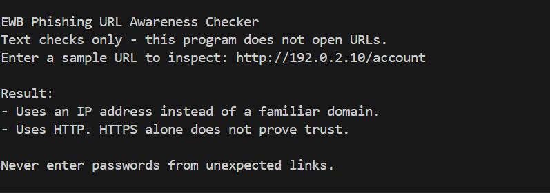
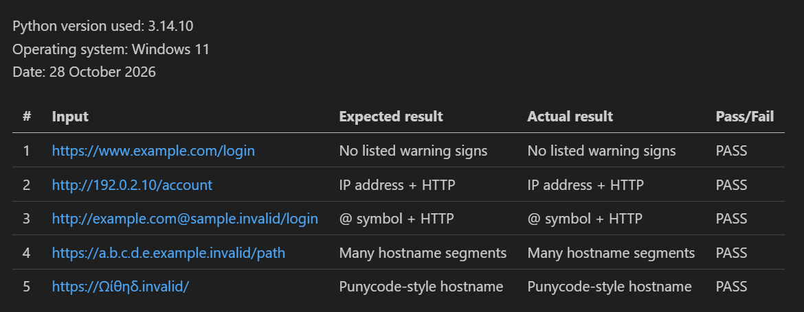

# EWB Phishing URL Awareness Checker

## Overview

Phishing is a cyberattack in which attackers use deceptive messages or websites to trick people into revealing sensitive information, such as passwords or banking details.

The Phishing URL Awareness Checker is a Python-based educational tool that examines URL text for common phishing warning signs. It helps users recognize potentially suspicious links without visiting websites or making internet requests.

## Features

- Detects an @ symbol in the URL.
- Flags unusually long URLs (over 100 characters).
- Flags IP-address hostnames.
- Flags many hostname segments (5 or more).
- Flags punycode-style hostnames containing xn--.
- Flags URLs using HTTP instead of HTTPS.
- Allows users to check multiple URLs without restarting the program.
- Handles malformed URL input without crashing.

## Requirements

- Python 3.10 or later
- Visual Studio Code (recommended)
- No additional Python packages required

The project uses Python's built-in `re` and `urllib.parse` libraries.

## How to Run

1. Open the `phishing-url-awareness` folder in VS Code.
2. Open the terminal.
3. Run the appropriate command.

Windows:

```powershell
py phishing_checker.py
```

Alternatively:

```powershell
python phishing_checker.py
```

Mac/Linux:

```bash
python3 phishing_checker.py
```

4. Enter a sample URL when prompted.
5. Read the warning signs displayed.
6. Enter another URL or type `q` to quit.

## Example Output

The following output is from the original program before adding the improvements:

```text
PS C:\...\phishing-url-awareness> py phishing_checker.py

EWB Phishing URL Awareness Checker
Text checks only - this program does not open URLs.
Enter a sample URL to inspect: http://192.0.2.10/account

Result:
- Uses an IP address instead of a familiar domain.
- Uses HTTP. HTTPS alone does not prove trust.

Never enter passwords from unexpected links.
```

The tool identifies two warning signs in this example:
- The hostname is an IP address.
- The URL uses HTTP.

These warnings do not prove that the URL is malicious.

## Testing

The five original test cases were executed successfully using the starter program.

| # | Input | Expected | Actual | Result |
|---|-------|----------|--------|--------|
| 1 | https://www.example.com/login | No warning signs | No listed warning signs | PASS |
| 2 | http://192.0.2.10/account | IP address + HTTP | IP address + HTTP | PASS |
| 3 | http://example.com@sample.invalid/login | @ symbol + HTTP | @ symbol + HTTP | PASS |
| 4 | https://a.b.c.d.e.example.invalid/path | Many hostname segments | Many hostname segments | PASS |
| 5 | https://xn--example.invalid/ | Punycode-style hostname | Punycode-style hostname | PASS |

Detailed test evidence is available in `tests/test_samples.md`.

The five tests should also be repeated after making code improvements to ensure the existing features still work correctly.

## Screenshots

### Sample Program Run



### Test Results



## Improvements

### 1. Loop with Quit Command (Option A)

**What changed:**

I added a `while True` loop to the `main()` function. The program now allows users to enter multiple URLs without restarting Python. Users can type `q`, `quit`, or `exit` to stop the program.

**Why it was added:**

The original program accepted only one URL at a time. The loop makes the checker easier and more convenient to use.

**How to test:**

Enter two sample URLs consecutively and verify that both results are displayed. Then enter `q` and confirm that the program exits normally.

### 2. Malformed URL Handling (Option C)

**What changed:**

I added `try` and `except ValueError` handling around URL parsing and hostname extraction.

**Why it was added:**

The original program could crash when users entered malformed URLs. The improved version displays a clear message instead.

**How to test:**

Enter:

`http://[bad`

Expected result:

`This text is not a valid URL format.`

The program should continue running without crashing.

## Limitations

- This is an educational awareness tool, not a complete phishing detection system.
- It only examines URL text.
- It does not open websites or make internet requests.
- It does not scan websites for malware.
- A warning sign does not prove that a URL is malicious.
- No warning signs found does NOT mean that a URL is safe.
- Some suspicious URLs may not match the detection rules.

## Ethical Use

This project is intended for defensive cybersecurity education.

Use sample URL strings only. Do not collect passwords, credentials, or personal information. Do not use this tool to deceive anyone or test websites without permission.

## Author

Chithra  
EWB Courses - Cybersecurity Mini Project
